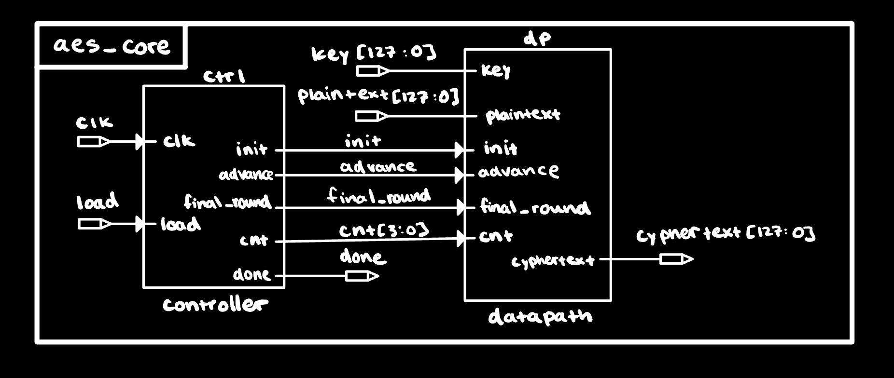
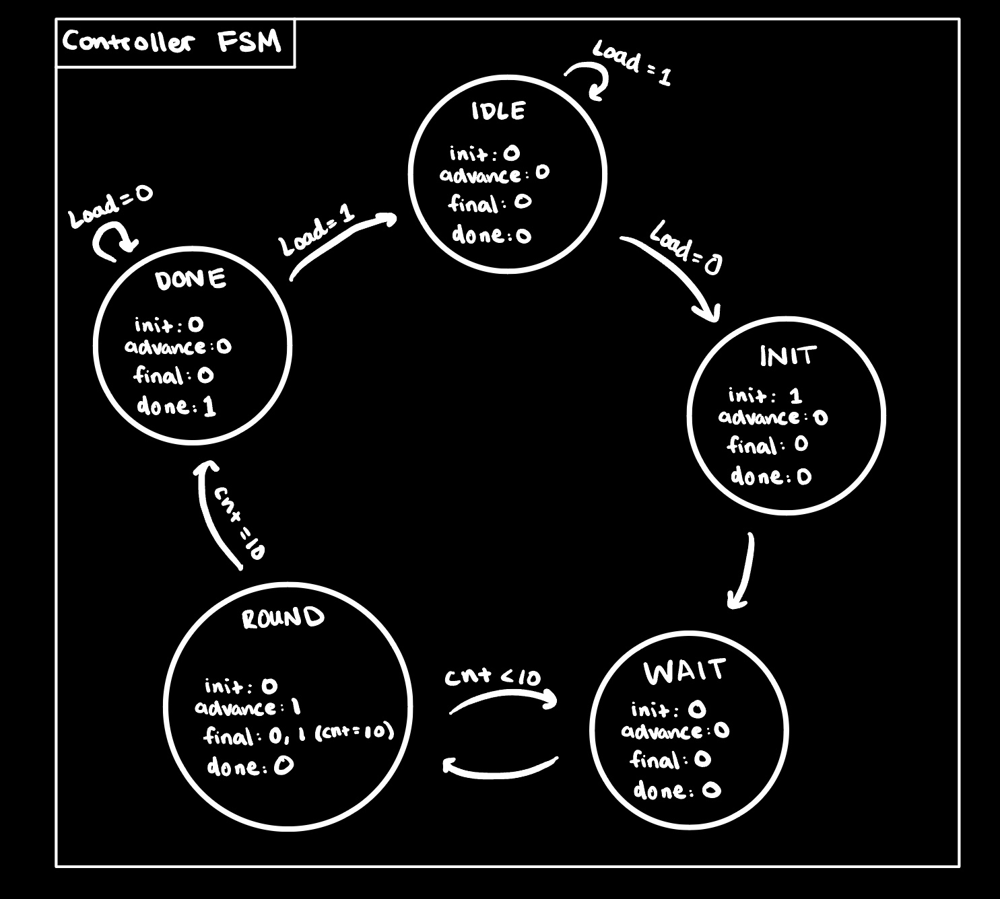
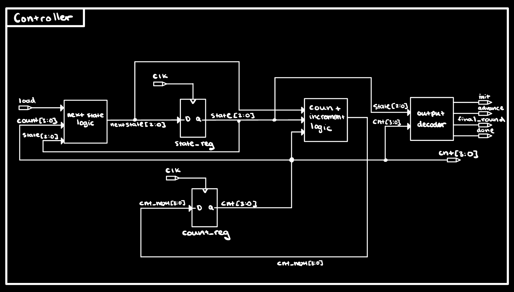
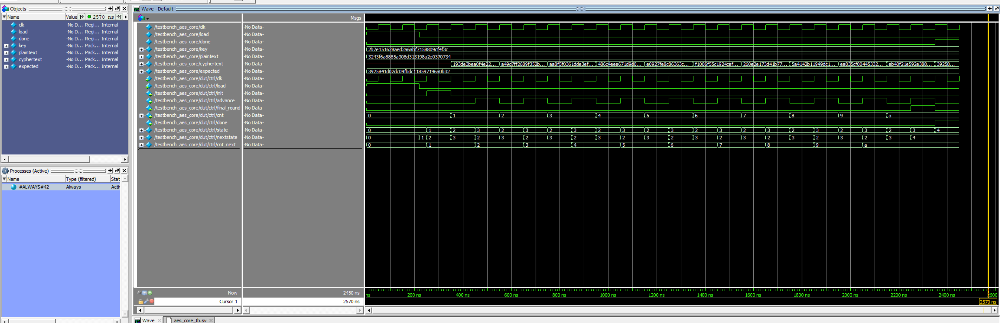
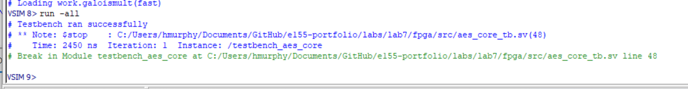
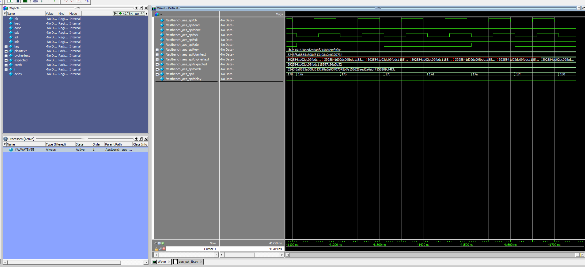
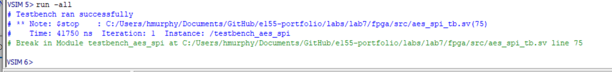

## Introduction
Lab 7 builds a hardware AES-128 encryption accelerator on an FPGA (Lattice iCE40 UP5K) and verifies it against a given test vector (directly from FIPS-197). The STM32L432KC MCU acts as the controller: it drives signals: 'load' low to initiate a transaction, shifts a 128-bit key and 128-bit plaintext into the FPGA over SPI, polls the FPGA's 'done' output, then shifts the resulting 128-bit ciphertext back out and compares it against the known-good value '3925841D02DC09FBDC118597196A0B32'. Success lights PA9; failure lights PA10.

## Design and Methology
::: {.callout-note}
For this design, the AES core decomposes into three authored modules plus three helpers. 'controller' is a 5-state FSM that sequences one init cycle, ten 'advance' cycles separated by 'wait' cycles (used to absorb the 1-cycle sbox BRAM latency), and holds 'done' high at the end. 'datapath' carries the 128-bit state and 128-bit round key through SubBytes → ShiftRows → MixColumns → AddRoundKey each cycle. 'nextkey' computes the next-round key combinationally from the previous key and round number, using 'rotword', 'subword', and an 'rcon' lookup table (given in FIPS-197).
:::

### Controller FSM
Five states denoted by 3-bit encoding, outputs: 'IDLE (0)', 'INIT (1)', 'WAIT (2)', 'ROUND (3)', 'DONE (4)'. 'IDLE → INIT' triggers on falling edge of 'load'. 'INIT' asserts 'init' to assign  'state = key ^ plaintext' and 'key_stored = key', and sets 'cnt = 1'. Each 'WAIT / ROUND' pair performs one AES round: 'WAIT' gives the synchronous sbox one cycle to settle, 'ROUND' asserts 'advance' to assign the next state and next key. On 'cnt == 10', 'ROUND' also asserts 'final_round' (which selects 'shifted' instead of 'mixed' for AddRoundKey), then transitions to 'DONE'. 'DONE' asserts 'done' and holds until 'load' goes high again.

### Datapath
Sixteen 'sbox_sync' instances (one per state byte, mapped to BRAM) produce 'sub' on the next clock edge. 'shifted' reorders those bytes per the AES ShiftRows table combinationally. 'mixcolumns' performs the GF(2^8) column mix. A 2:1 mux selects between 'mixed' (for normal rounds) and 'shifted' (for the final round) via 'final_round' where the result is XOR'd with 'next_key' to produce 'round_out'. The 'state_stored' register assigns 'state_next = init ? (key ^ plaintext) : round_out' whenever 'init | advance'. The 'key_stored' register assigns 'key' on 'init' and 'next_key' otherwise. 'cyphertext' is tied to 'state_stored'.

### KeyExpansion (nextkey)
Combinational logic following FIPS-197 §5.2 for Nk=4:

- 'nw0 = w0 ^ SubWord(RotWord(w3)) ^ Rcon[cnt]'
- 'nw1 = nw0 ^ w1'
- 'nw2 = nw1 ^ w2'
- 'nw3 = nw2 ^ w3'

'rotword' is a wire-level byte rotation. 'subword' instantiates four sboxes in parallel on the four bytes of its input. The 'rcon_lut' is a 'case (cnt)' returning the standard Rcon sequence '01, 02, 04, 08, 10, 20, 40, 80, 1B, 36' in the high byte.

### Oscillator and clocking
The iCE40 UP5K's internal 48 MHz oscillator must be explicitly instantiated. The top-level 'aes' module declares 'clk' as an internal signal and brings up the oscillator with:
```verilog
SB_HFOSC #(.CLKHF_DIV("0b10")) hfosc_inst (
    .CLKHFPU(1'b1),
    .CLKHFEN(1'b1),
    .CLKHF(clk)
);
```
### Testing
Two provided testbenches validated the design before hardware:

- 'aes_core_tb.sv' — which drives the FIPS-197 test vector: plaintext '00112233445566778899AABBCCDDEEFF', and key '000102030405060708090A0B0C0D0E0F' directly into 'aes_core' and checks the ciphertext.
- 'aes_spi_tb.sv' — exercises the full top-level 'aes' through its SPI port, mimicking the MCU's shift-in / wait-for-done / shift-out protocol.

### Technical Documentation
The source code for the FPGA core and the full SEGGER project for the MCU can be found in the '/labs/lab7/fpga/' and '/labs/lab7/mcu/' directories of the following [GitHub repository](https://github.com/hlmurphy/e155-portfolio).

## Documentation

### Top-level block diagram (aes)
{#fig-top width=80%}

### aes_core block diagram
{#fig-core width=80%}

### Controller FSM state diagram
{#fig-fsm width=70%}

### Controller structural block diagram                                                
{#fig-ctrl-struct width=80%}

### Datapath block diagram
{#fig-datapath width=85%}

### KeyExpansion (nextkey) block diagram
![Key expansion for one round. four 32-bit words. 'w3' passes through 'rotword' and then 'subword' (four parallel sboxes), is XOR'd with 'Rcon[cnt]', and feeds a cascanw0..nw3'. The resulting 128bits form 'next_key'.](images/nextkey.png){#fig-nextkey width=80%}

### Pin Mapping


## Results and Discussion
Both testbenches passed with the FIPS-197 standard vector:

- Plaintext: `00112233445566778899AABBCCDDEEFF`
- Key: `000102030405060708090A0B0C0D0E0F`
- Expected ciphertext: `3925841D02DC09FBDC118597196A0B32`

### Simulation
{#fig-core-wave width=90%}

{#fig-core-console width=90%}

{#fig-spi-wave width=90%}

{#fig-spi-console width=90%}

### Hardware Testing

With the bitstream programmed to the UP5K and the MCU reset after both boards had powered up, PA9 (success LED) lit, confirming the FPGA produced the correct ciphertext end-to-end.

An interesting edge case appeared during cold-start: PA10 (fail LED) would light on initial power-up, and PA9 only lit after an MCU reset. The cause is that the FPGA reads its bitstream from external SPI flash on power-up (takes several ms) and the oscillator requires a brief stabilization window after that, whereas the MCU boots and reaches 'encrypt()' within a different time window.

### SPI Protocol Matching
::: {.callout-note} 
Both ends of the SPI link run in **Mode 0 (CPOL=0, CPHA=0)**. On the MCU side, 'lab7.c' calls 'initSPI(1, 0, 0)'', which writes zeros into the 'SPI_CR1.CPOL' and 'SPI_CR1.CPHA' fields, indicating that SCK idles low and the master samples MISO on the leading (rising) edge. On the FPGA side, the provided 'aes_spi' module captures 'sdi' on the posedge and updates 'sdo' on negedge of 'sck'. This matches Mode 0 by construction: data is set up on the falling edge in between and stable at every rising-edge sample point.
:::

## Summary & Conclusion
The design meets the Proficiency hardware requirement for the lab's specification: the FPGA receives a 128-bit AES-128 key and 128-bit plaintext over SPI from the STM32L432KC, computes the correct ciphertext per FIPS-197 Appendix B in a Moore-controlled pipelined datapath, asserts 'done' to signal completion, and shifts the ciphertext back over SPI for the MCU to verify. Hardware verification lit PA9 (success).

::: {.callout-tip title="Compliance"}
This submission meets every Proficiency requirement in the Lab 7 spec.
:::


## AI Prototype Summary
### Reflection 

### Hours Spent

- Lit Review: 4 Hours
- Design Ideation and Block Diagrams: 7 Hours 
- Verilog Synthesis: 3 Hours
- Simulation (via testbenches): 4 Hours
- Hardware bringup & Debugging: 2 Hours
- Write Up: 3 Hours
- Total: 23 Hours